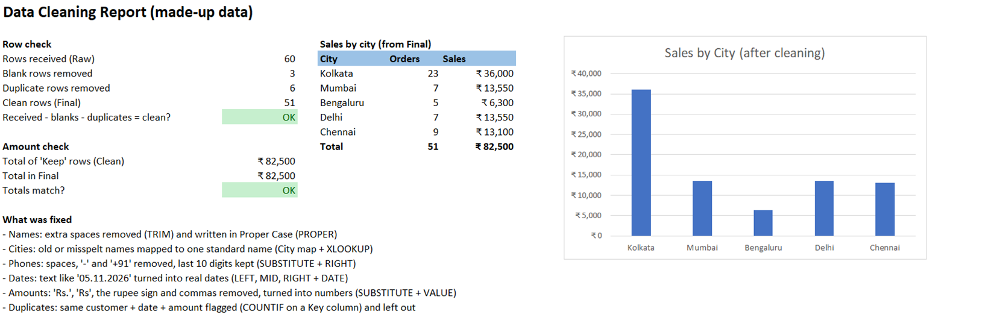
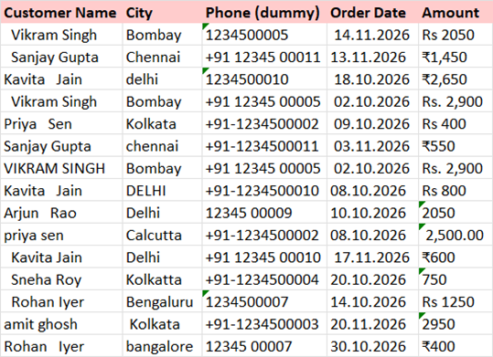
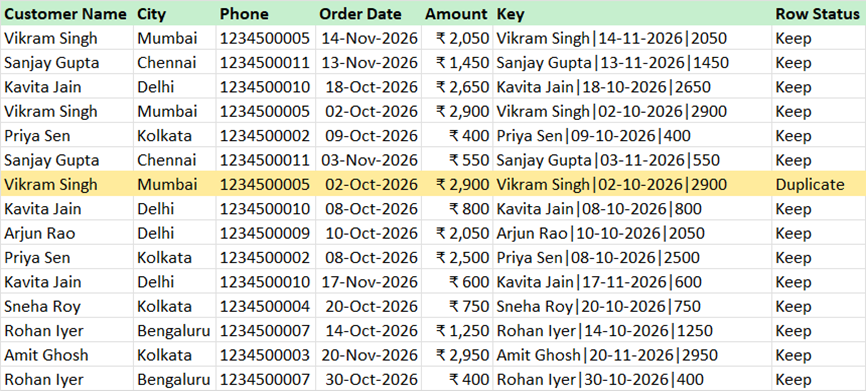
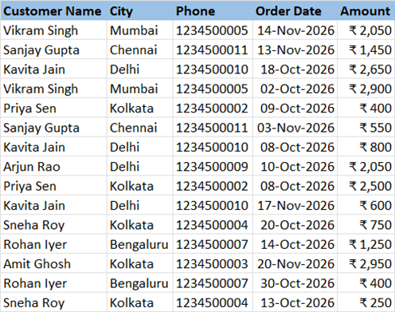

# 🧹 Data Cleaning: Messy Export to Clean List (Excel)

### 📖 Overview
A messy customer-orders export cleaned in **Microsoft Excel**, with a checks sheet that proves nothing was lost.
The raw sheet is never edited: every fix is a formula, so the same cleaning works again on next month's export.
*All data is made up (60 raw rows), for demonstration only. Phone numbers are dummy values.*

### 🧩 Problems in the raw data
- Extra spaces and mixed case in names ("  Vikram Singh", "priya sen", "KAVITA   JAIN")
- Old or misspelt city names (Calcutta, Kolkatta, Bombay, Banglore, Madras)
- Phone numbers in four different formats (+91-, spaces, no spaces)
- Dates stored as text ("14.11.2026")
- Amounts stored as text ("Rs. 2,900", "₹1,450", " 2,500.00 ")
- 6 duplicate orders (some only visible after cleaning) and 3 blank rows

### 🧰 How it was cleaned
- **Names:** TRIM + PROPER
- **Cities:** a small City map table + XLOOKUP (unknown names are kept as they are)
- **Phones:** SUBSTITUTE to remove spaces, "-" and "+", then RIGHT to keep the last 10 digits
- **Dates:** LEFT, MID and RIGHT to split day, month and year, then DATE
- **Amounts:** SUBSTITUTE to remove "Rs.", "Rs", the rupee sign and commas, then VALUE
- **Duplicates:** a Key column (name + date + amount) and `COUNTIF($F$2:F2, F2)` to flag repeats while keeping the first copy
- **Final list:** one FILTER formula keeps only the good rows

### ✅ Checks
- 60 rows received − 3 blank − 6 duplicates = 51 clean rows → **OK**
- Total of kept rows = total in the final list = ₹82,500 → **OK**
- Sales by city summary and chart from the clean list

### 💡 Skills Demonstrated
Data Cleaning · TRIM · PROPER · SUBSTITUTE · VALUE · LEFT / MID / RIGHT · DATE · XLOOKUP · COUNTIF · FILTER · SUMIFS · Conditional Formatting

### 🖼️ Project Preview
#### Checks report

#### Before: raw export

#### After: cleaned rows with status

#### Final clean list

### 📁 Files
- [`data-cleaning.xlsx`](./data-cleaning.xlsx): Excel workbook (sheets: Checks, Raw, Clean, Final, CityMap)
- [`Checks.png`](./Checks.png), [`Raw.png`](./Raw.png), [`Clean.png`](./Clean.png), [`Final.png`](./Final.png): screenshots
