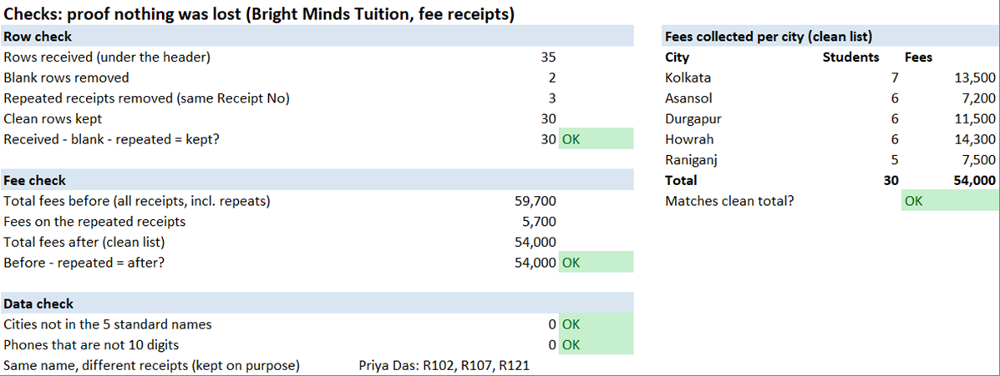
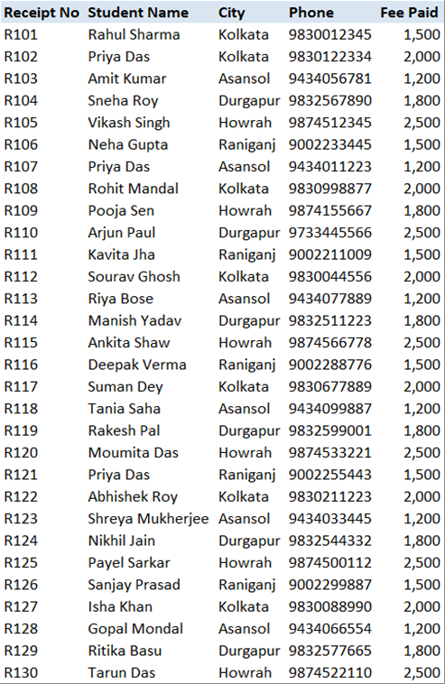
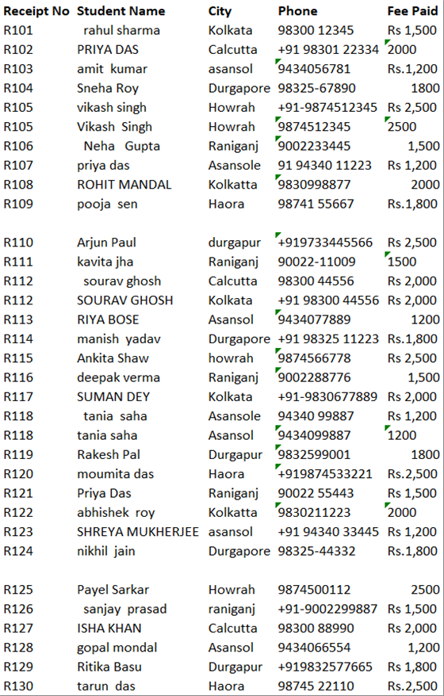

# 🧾 Client Brief to Delivery: Fee Receipts Cleaning (Excel)

### 📖 Overview
A practice order done like a real freelance job: a (made-up) tuition centre, *Bright Minds Tuition*, sends a messy month of fee receipts and a list of 9 requests. I cleaned the data with formulas only, proved nothing was lost, answered the client's question (fees per city) and wrote the delivery message.
*All data is made up, for demonstration only.*

### 📩 The client's brief (short version)
1. Student names in proper case, no extra spaces
2. One spelling per city, using only: Kolkata, Asansol, Durgapur, Howrah, Raniganj
3. Phone numbers as plain 10 digits
4. Fee Paid as a real number
5. Remove receipts typed twice, **but** some students share a name and must stay
6. Remove blank rows
7. Don't change the original sheet
8. Show proof nothing was lost (rows and fee totals, before and after)
9. Tell me the total fees collected per city

### 🧩 What was wrong with the data
- Names like "  rahul sharma", "PRIYA DAS", "amit  kumar "
- Cities typed many ways: Calcutta, Kolkatta, Asansole, Durgapore, Haora
- Phones in 6 formats: "98300 12345", "+91 98301 22334", "98325-67890", "+919733445566", "91 94340 11223"
- Fees as text: "Rs 1,500", "Rs.1,200", "2000"
- 3 receipts typed twice (R105, R112, R118), each time with different spacing or format
- 2 blank rows
- **The trap:** 3 different students named "Priya Das" (R102, R107, R121). Removing duplicates by name would wrongly delete 2 of them, so duplicates are found by **Receipt No**.

### 🧰 How it was cleaned (formulas only, original untouched)
| Column | Formula idea |
|---|---|
| Name | `PROPER(TRIM(...))` |
| City | small spelling map + `XLOOKUP(LOWER(TRIM(...)), ...)` |
| Phone | `SUBSTITUTE` spaces, dashes and "+", then `RIGHT(..., 10)` |
| Fee | `SUBSTITUTE` "Rs.", "Rs", commas, spaces, then `VALUE` |
| Status | blank → "Blank"; `COUNTIF($A$2:A2, A2) > 1` → "Duplicate"; else "Keep" |
| Final list | `FILTER(..., Status = "Keep")` |

### ✅ Result
- 35 rows received − 2 blank − 3 repeated receipts = **30 clean rows**
- Fees: 59,700 before − 5,700 on repeated receipts = **54,000 after**
- Per city: Kolkata 13,500 · Asansol 7,200 · Durgapur 11,500 · Howrah 14,300 · Raniganj 7,500 (total 54,000)
- Every check on the Checks sheet shows **OK**

### 💡 Skills Demonstrated
Reading a client brief · Data cleaning · TRIM · PROPER · SUBSTITUTE · VALUE · RIGHT · XLOOKUP · COUNTIF (running count) · FILTER · SUMIFS · Conditional formatting · Data reconciliation

### 🖼️ Project Preview
#### Checks: proof nothing was lost, plus fees per city

#### After: clean list

#### Before: the client's original sheet (unchanged)

### 📁 Files
- [`fee-receipts-cleaning.xlsx`](./fee-receipts-cleaning.xlsx): sheets Checks, Clean, Raw (original), Working (formulas and Status), Cities (spelling map)
- Screenshots: Checks.png, Clean.png, Raw.png
