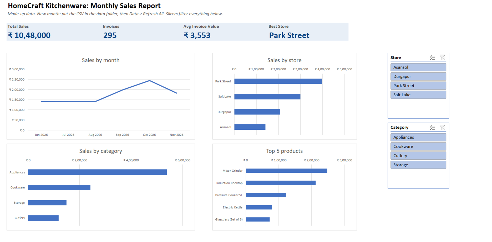
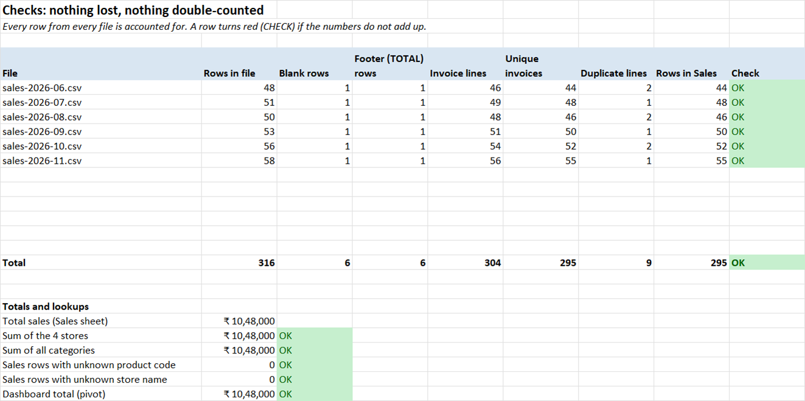
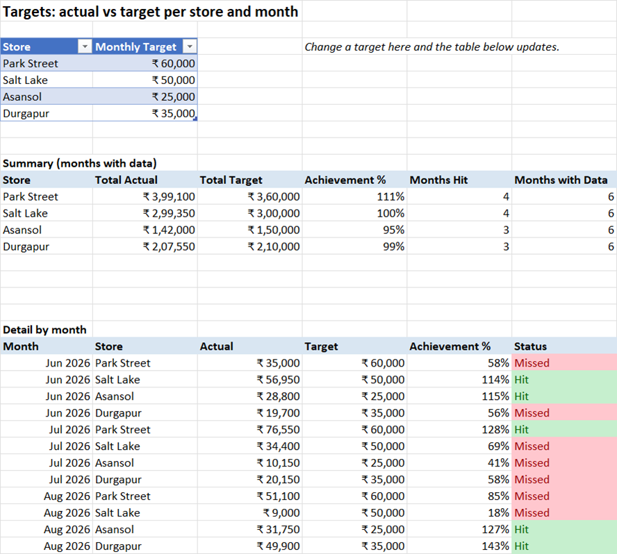
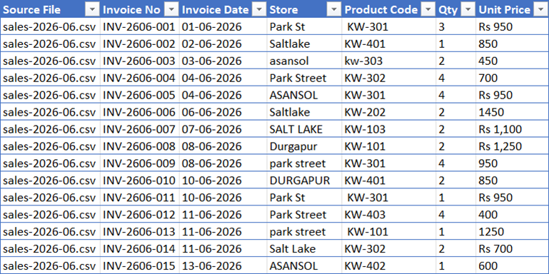
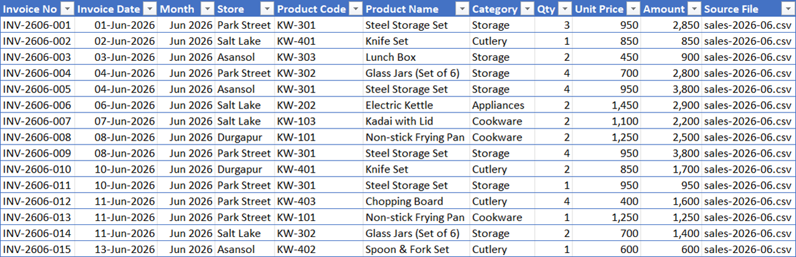

# 🔄 Self-Refreshing Monthly Sales Report (Excel + Power Query)

### 📖 Overview
A monthly sales report for a (made-up) kitchenware retailer with 4 stores. Each month the billing system exports a messy CSV file.
**Power Query** reads every file in the `data` folder, cleans it, adds product names and categories, and feeds a dashboard.
When next month's file arrives, you drop it into the folder and click **Data → Refresh All**. Nothing is rebuilt by hand.
*All data is made up (6 monthly files, 316 raw lines), for demonstration only.*

### 🧩 Problems in the monthly exports
- A blank row and a "TOTAL" footer row in every file
- The same invoice exported twice (9 duplicate lines)
- Store names typed in different ways ("Park St", "PARK STREET", "Saltlake", " salt lake")
- Product codes with extra spaces and lowercase ("kw-101 ")
- Prices stored as text ("Rs 1,250")
- Dates as text in Indian format (01-06-2026 = 1 June, not 6 January)
- No product names or categories in the export

### 🧰 How Power Query cleans it (one recipe for every month)
1. **From Folder**: read all CSV files in `data` and stack them, keeping the file name
2. Remove blank rows and "TOTAL" footer rows
3. Remove duplicate invoices (by Invoice No)
4. Trim and capitalise store names, then fix "Park St" and "Saltlake" (whole-cell replace)
5. Trim and uppercase product codes
6. Remove "Rs" and commas from prices, convert Qty and Price to numbers
7. Convert dates using the Indian (en-IN) date format
8. **Merge** with the Products table to add Product Name and Category (like XLOOKUP)
9. Add **Amount** = Qty × Unit Price and **Month**

### 📊 What the workbook shows
- **Dashboard**: Total Sales, Invoices, Average Invoice Value, Best Store; sales by month, by store, by category, top 5 products; Store and Category slicers filter everything
- **Targets**: actual vs monthly target for every store and month (SUMIFS + XLOOKUP), Hit / Missed
- **Checks**: for every file, rows in = blank + footer + duplicates + rows kept → **OK**; totals by store and category match; 0 unknown products or stores

### ✅ Result (June–November)
- 316 raw lines → 295 clean sales, ₹10,48,000
- Best store: Park Street (111% of target). Asansol missed its target in 3 of 6 months
- Tested: adding the December file + Refresh All → 345 sales, ₹12,68,500, all checks OK

### 🧪 Try it yourself
1. Download this folder and open `monthly-sales-report.xlsx`
2. On the **Settings** sheet, change cell B3 to the full path of the `data` folder on your computer
3. Copy `next-month/sales-2026-12.csv` into `data`
4. Click **Data → Refresh All** and watch December appear on the Dashboard, Targets and Checks

### 💡 Skills Demonstrated
Power Query (From Folder, Remove Rows, Remove Duplicates, Replace Values, Change Type with Locale, Merge Queries, Custom Column) · Pivot Tables · Pivot Charts · Slicers · GETPIVOTDATA · SUMIFS · XLOOKUP · UNIQUE / FILTER · Conditional Formatting · Data Reconciliation

### 🖼️ Project Preview
#### Dashboard

#### Checks

#### Targets

#### Before: raw monthly export (stacked)

#### After: clean sales with product names and categories

### 📁 Files
- [`monthly-sales-report.xlsx`](./monthly-sales-report.xlsx): Excel workbook (sheets: Dashboard, Targets, Checks, Sales, Raw, Products, Settings)
- [`data/`](./data): 6 monthly CSV exports (June–November 2026)
- [`next-month/`](./next-month): December file for the refresh test
- Screenshots: Dashboard.png, Checks.png, Targets.png, Raw.png, Sales.png
