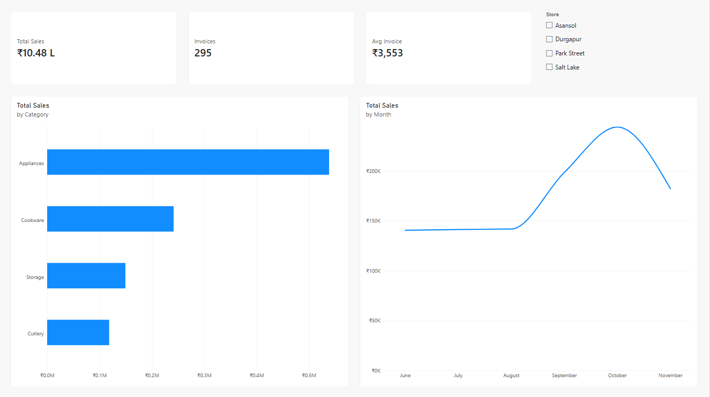
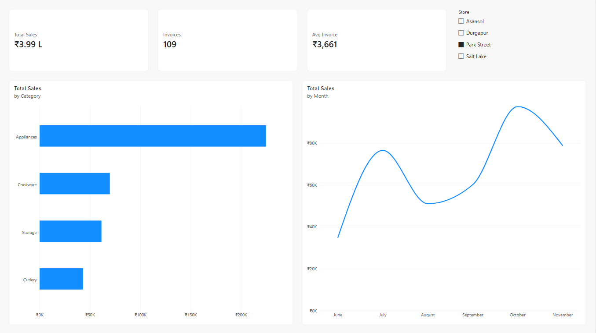
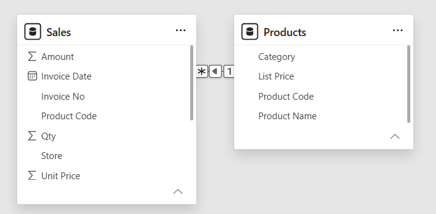

# 📊 Kitchenware Sales Dashboard (Power BI)

### 📖 Overview
My first Power BI project: an interactive sales dashboard for a (made-up) kitchenware retailer with 4 stores (June–November 2026).
It uses the clean sales data from my [Monthly Sales Report](../Monthly-Sales-Report) project, so every number can be checked against Excel.
*All data is made up, for demonstration only.*

### 🧩 Data model
Two tables, linked instead of merged:
- **Sales**: 295 invoices (Invoice No, Invoice Date, Store, Product Code, Qty, Unit Price, Amount)
- **Products**: 12 products (Product Code, Product Name, Category, List Price)
- **Relationship**: Products[Product Code] **1 → \*** Sales[Product Code] (one product, many sales)

Because of the relationship, a chart can show **Sales by Category** even though the Sales table has no Category column. Power BI looks up the category through the link, the same idea as XLOOKUP but set up once for the whole report.

### 🧮 DAX measures
```
Total Sales  = SUM(Sales[Amount])
Invoices     = COUNTROWS(Sales)
Avg Invoice  = DIVIDE([Total Sales], [Invoices])
Sales Label  = "₹" & FORMAT([Total Sales] / 100000, "0.00") & " L"
Avg Label    = "₹" & FORMAT([Avg Invoice], "#,##0")
```
The two *Label* measures are only for the KPI cards, so the cards show **₹10.48 L** (lakhs) instead of an abbreviated "1M".

### 📊 What the dashboard shows
- **KPI cards**: Total Sales, Invoices, Average Invoice
- **Sales by Category** (bar chart)
- **Sales by Month** (line chart, axis starting at 0 so the trend isn't exaggerated)
- **Store slicer**: click a store and every visual filters

### ✅ Checks (Power BI vs Excel)
| Check | Power BI | Excel (project 4) |
|---|---|---|
| Total Sales | ₹10,48,000 | ₹10,48,000 ✓ |
| Invoices | 295 | 295 ✓ |
| Average Invoice | ₹3,553 | ₹3,553 ✓ |
| Park Street / Salt Lake / Durgapur / Asansol | 3,99,100 / 2,99,350 / 2,07,550 / 1,42,000 | same ✓ |
| Categories add up to the total | 5,38,450 + 2,41,600 + 1,49,500 + 1,18,450 = 10,48,000 | ✓ |

### 💡 Insights
- **Appliances** bring in over half of all sales (₹5,38,450).
- Sales were flat in June–August (about ₹1.4 L a month), rose in September and peaked in **October (₹2,43,950)**.
- **Park Street** is the biggest store (₹3,99,100).

### 💡 Skills Demonstrated
Power BI · Data modelling (one-to-many relationship) · DAX measures (SUM, COUNTROWS, DIVIDE, FORMAT) · Cards, bar and line charts · Slicers · Number formatting · Checking results against a second source

### 🖼️ Project Preview
#### Dashboard


#### Filtered to one store (Park Street)


#### Data model


### 📁 Files
- [`Kitchenware-Sales-Dashboard.pbix`](./Kitchenware-Sales-Dashboard.pbix): the Power BI file (open in Power BI Desktop, free)
- [`data/`](./data): `sales.csv` (295 clean invoices) and `products.csv` (12 products)
- Screenshots: Dashboard.png, Dashboard-Park-Street.png, Model.png
