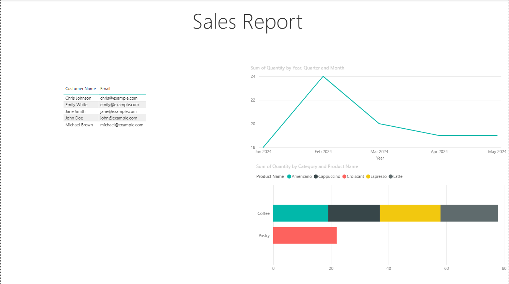
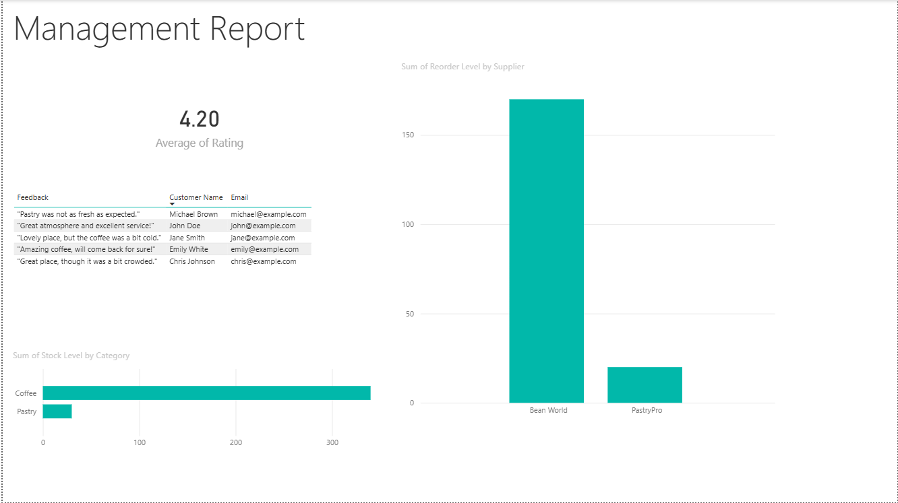
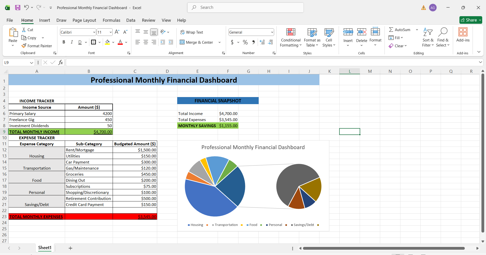
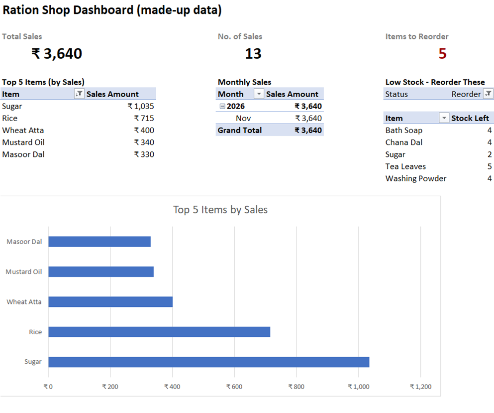
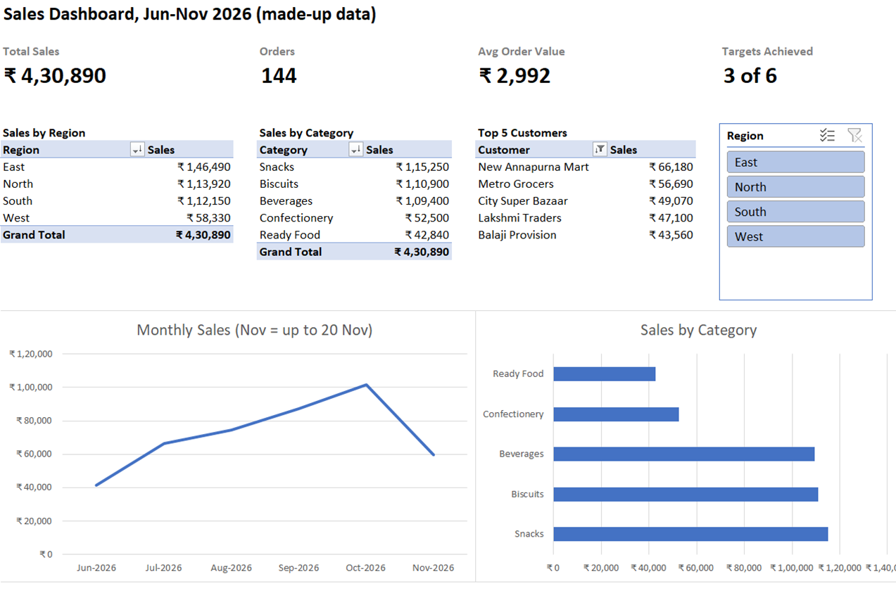
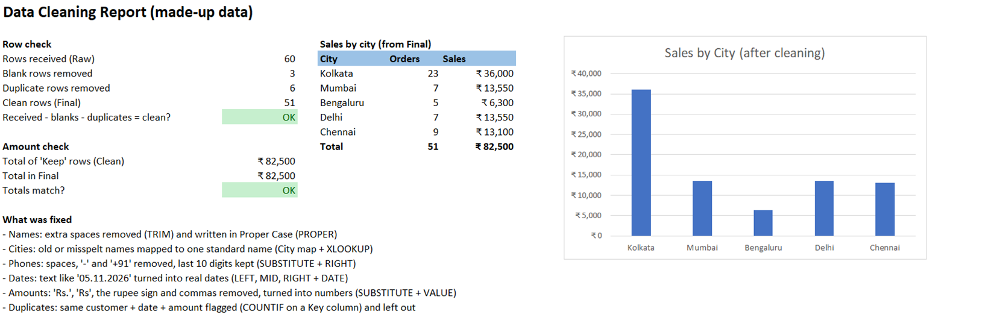
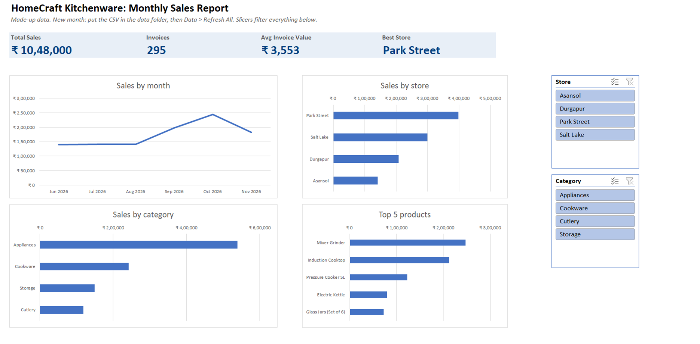
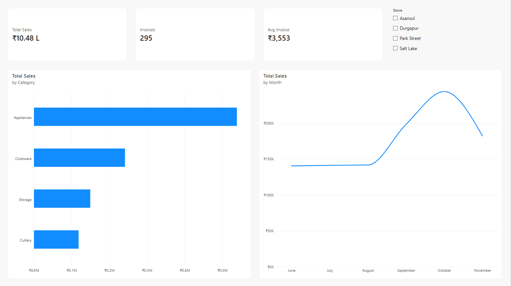
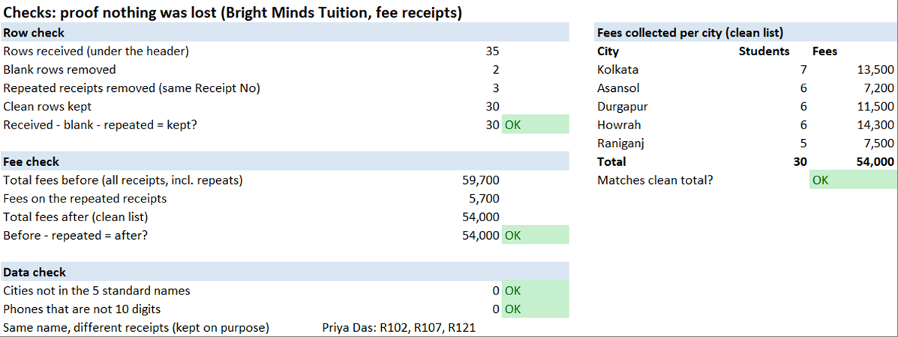

# Data Analytics Projects

Hands-on data analytics and visualization projects using **Power BI**, **Excel**, **PowerPoint** and **Canva**.
Built by **Aditya Kumar Gupta**, MBA (Marketing) | MIS & Business Analytics

### 📌 Projects in this repository
1. [☕ Brew Heaven Power BI Dashboard](#-brew-heaven-power-bi-dashboard)
2. [📊 Professional Monthly Financial Dashboard (Excel)](#-professional-monthly-financial-dashboard-excel)
3. [🎨 How To Visualize Your Data Using Microsoft PowerPoint](#-how-to-visualize-your-data-using-microsoft-powerpoint)
4. [🎨 Get Started with Canva](#-get-started-with-canva)
5. [🛒 Ration Shop Stock & Sales Tracker (Excel)](#-ration-shop-stock--sales-tracker-excel)
6. [📈 Sales Dashboard: Regions, Products & Targets (Excel)](#-sales-dashboard-regions-products--targets-excel)
7. [🧹 Data Cleaning: Messy Export to Clean List (Excel)](#-data-cleaning-messy-export-to-clean-list-excel)
8. [🔄 Self-Refreshing Monthly Sales Report (Excel + Power Query)](#-self-refreshing-monthly-sales-report-excel--power-query)
9. [📊 Kitchenware Sales Dashboard (Power BI)](#-kitchenware-sales-dashboard-power-bi)
10. [🧾 Client Brief to Delivery: Fee Receipts Cleaning (Excel)](#-client-brief-to-delivery-fee-receipts-cleaning-excel)

---

## ☕ Brew Heaven Power BI Dashboard

### 📖 Overview
An interactive Power BI dashboard for **Brew Heaven**, a local coffee shop chain, bringing together sales, inventory and customer feedback data.
The dashboard gives insights into:
- Sales trends and product performance
- Customer satisfaction and feedback
- Stock levels and reorder management

### 🧰 Features
- Two interactive report pages: **Sales Page** and **Management Page**
- Sales visualized **by category, time and product**
- **Customer feedback** integrated, with **average ratings** calculated
- **Power Query** used for data transformation and cleaning

### 💡 Skills Demonstrated
Power BI · Data Cleaning & Modeling · Data Visualization · DAX Calculations · Business Insights & Reporting

### 🖼️ Project Preview
#### Sales Page

#### Management Page

### 📁 Files
- [`final.pbix`](./final.pbix): Power BI project file
- [`Sales_Page.png`](./Sales_Page.png), [`Management_Page.png`](./Management_Page.png): report screenshots

---

## 📊 Professional Monthly Financial Dashboard (Excel)

### 📖 Overview
A financial tracking dashboard built in **Microsoft Excel** to monitor and analyze monthly income, expenses and savings using formulas and charts.

### 🧰 Features
- Income and expense tracking
- Budget vs. actual comparison
- Automatic calculation of monthly savings
- Pie chart of expense categories

### 💡 Skills Demonstrated
Excel Formulas · Data Visualization · Charting & Formatting · Financial Analysis

### 🖼️ Project Preview

### 📁 Files
- [`Professional Monthly Financial Dashboard.xlsx`](./Professional%20Monthly%20Financial%20Dashboard.xlsx): Excel dashboard
- [`Dashboard_Preview.png`](./Dashboard_Preview.png): screenshot

---

## 🎨 How To Visualize Your Data Using Microsoft PowerPoint

### 📖 Overview
A hands-on Coursera guided project on creating engaging PowerPoint presentations for data storytelling and visualization.

### 🧰 Features
- Data-driven visuals using SmartArt and charts
- Storytelling that combines visuals, transitions and animations
- Professional presentation layouts

### 💡 Skills Demonstrated
Data Visualization · Storytelling with Data · Microsoft PowerPoint · Presentation Design

### 📁 Files
- [`Project Presentation for Learners 1.odp`](./Project%20Presentation%20for%20Learners%201.odp): editable version
- [`Project Presentation for Learners 1.pdf`](./Project%20Presentation%20for%20Learners%201.pdf): read-only version

**Credential:** [View Certificate on Coursera](https://coursera.org/share/6a19eef91fd70cd4c6c44b9eb04c0059)

---

## 🎨 Get Started with Canva

### 📖 Overview
Coursera guided project *“Get Started with Canva”* on foundational digital design and multimedia creation.
Created a 21-second animated video sharing COVID-19 safety guidelines, using stock images, vector graphics and animated text.

### 🧰 Features
- Animated video made entirely in Canva
- Slide-based layout with smooth transitions
- Canva’s motion, timing and layering tools

### 💡 Skills Demonstrated
Canva · Graphic Design · Video Editing · Storytelling · Visual Communication

### 📁 Files
- 🎥 [Watch the Canva project video](./Get_Started_With_Canva_Project.mp4)

**Credential:** [View Certificate on Coursera](https://coursera.org/share/64864fa5a75004ad6eb2a887149ddec8)

---

## 🛒 Ration Shop Stock & Sales Tracker (Excel)

### 📖 Overview
A stock and sales tracker for a small ration (grocery) shop, built in **Microsoft Excel**. Sales and purchases go in; Excel works out prices, current stock and what to reorder, and shows it on one dashboard.
*All data is made up, for demonstration only.*

### 💡 Skills Demonstrated
Excel Tables · XLOOKUP · SUMIFS · Data Validation · IF · COUNTIF · Conditional Formatting · Pivot Tables · Pivot Charts

### 🖼️ Project Preview

➡️ Full details, more screenshots and the Excel file: [Ration-Shop-Tracker folder](./Ration-Shop-Tracker)

---

## 📈 Sales Dashboard: Regions, Products & Targets (Excel)

### 📖 Overview
A sales dashboard for a snacks and beverages distributor, built in **Microsoft Excel**: sales by region, category and customer, month-to-month growth, and target vs actual for each salesperson. One slicer filters every pivot.
*All data is made up, for demonstration only.*

### 💡 Skills Demonstrated
Excel Tables · XLOOKUP · SUMIFS · COUNTIFS · TEXT & DATE · Conditional Formatting · Pivot Tables · Slicers · Charts

### 🖼️ Project Preview

➡️ Full details, more screenshots and the Excel file: [Sales-Dashboard folder](./Sales-Dashboard)

---

## 🧹 Data Cleaning: Messy Export to Clean List (Excel)

### 📖 Overview
A messy customer-orders export (extra spaces, old city names, text dates and amounts, duplicates, blank rows) cleaned in **Microsoft Excel** with formulas only, plus a checks sheet proving the row counts and totals match.
*All data is made up, for demonstration only.*

### 💡 Skills Demonstrated
Data Cleaning · TRIM · PROPER · SUBSTITUTE · VALUE · LEFT / MID / RIGHT · DATE · XLOOKUP · COUNTIF · FILTER

### 🖼️ Project Preview

➡️ Before/after screenshots and the Excel file: [Data-Cleaning folder](./Data-Cleaning)

---

## 🔄 Self-Refreshing Monthly Sales Report (Excel + Power Query)

### 📖 Overview
Six messy monthly CSV exports from a (made-up) 4-store retailer, combined and cleaned with **Power Query**, merged with a product list, and shown on a dashboard with targets and checks. A new month = drop the file in the folder and click Refresh All.
*All data is made up, for demonstration only.*

### 💡 Skills Demonstrated
Power Query (From Folder, Merge Queries, locale dates) · Pivot Tables & Charts · Slicers · SUMIFS · XLOOKUP · Data Reconciliation

### 🖼️ Project Preview

➡️ Files, data and screenshots: [Monthly-Sales-Report folder](./Monthly-Sales-Report)

---

## 📊 Kitchenware Sales Dashboard (Power BI)

### 📖 Overview
My first Power BI project: an interactive dashboard for a (made-up) 4-store kitchenware retailer. Two tables (Sales and Products) are linked with a one-to-many relationship, and DAX measures drive KPI cards, sales by category, sales by month and a store slicer. Every number was checked against the Excel version (₹10,48,000, 295 invoices).
*All data is made up, for demonstration only.*

### 💡 Skills Demonstrated
Power BI · Data modelling (relationships) · DAX (SUM, COUNTROWS, DIVIDE, FORMAT) · Slicers · Checking results against a second source

### 🖼️ Project Preview

➡️ Power BI file, data and screenshots: [Power-BI-Sales-Dashboard folder](./Power-BI-Sales-Dashboard)

---

## 🧾 Client Brief to Delivery: Fee Receipts Cleaning (Excel)

### 📖 Overview
A practice order done like a real freelance job: a (made-up) tuition centre sends messy fee receipts and 9 requests. Cleaned with formulas only (names, cities, phones, text fees), repeated receipts removed by **Receipt No** (three different students share one name, so name-based de-duplication would be wrong), and a Checks sheet proves nothing was lost: 35 rows → 30 clean, fees 59,700 → 54,000, plus fees per city.
*All data is made up, for demonstration only.*

### 💡 Skills Demonstrated
Reading a client brief · TRIM · PROPER · SUBSTITUTE · VALUE · XLOOKUP · COUNTIF · FILTER · SUMIFS · Data reconciliation

### 🖼️ Project Preview

➡️ Excel file, brief and screenshots: [Fee-Receipts-Cleaning folder](./Fee-Receipts-Cleaning)

---

## 👤 Author
**Aditya Kumar Gupta**
📧 adityaa.guptaa17@gmail.com
🔗 [LinkedIn](https://www.linkedin.com/in/aditya-k-gupta-operations) · 🐙 [GitHub](https://github.com/aditya-gupta17)
