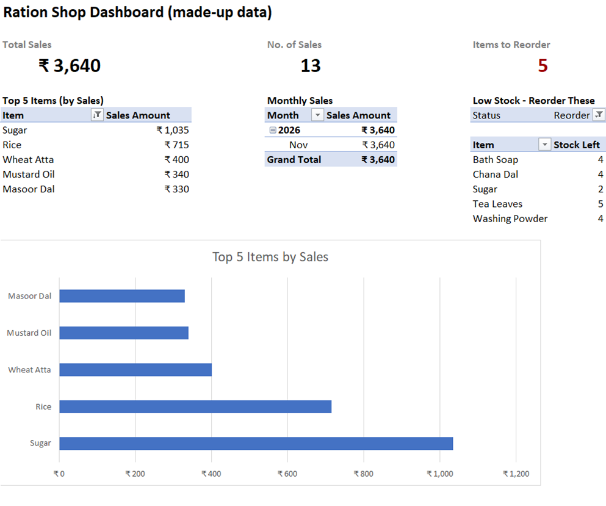
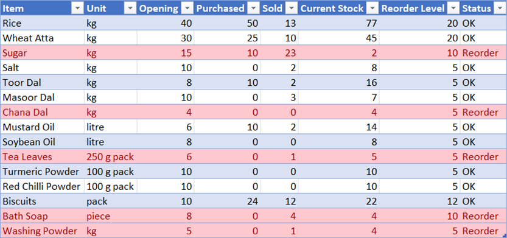
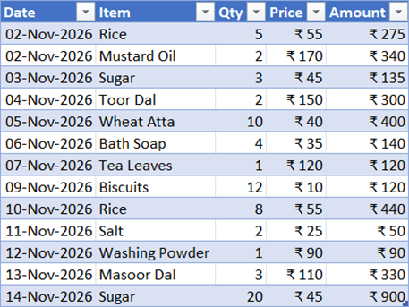

# 🛒 Ration Shop Stock & Sales Tracker (Excel)

### 📖 Overview
A stock and sales tracker for a small ration (grocery) shop, built in **Microsoft Excel**.
The shop owner records each sale and each purchase; Excel works out prices, current stock and what needs reordering, and shows it all on one dashboard.
*All data is made up, for demonstration only.*

### 🧰 Features
- **Items list** (15 items) with category, unit and price
- **Sales and Purchases sheets** with a dropdown for the item name, so wrong spellings are blocked
- **Price fills in automatically** with XLOOKUP; Amount = Qty × Price
- **Stock sheet**: Opening + Purchased − Sold = Current Stock, using SUMIFS
- **Low-stock alert**: items at or below their reorder level turn red
- **Dashboard**: total sales, number of sales, items to reorder, Top 5 items, monthly sales and a low-stock list
- Built on Excel Tables, so new rows pick up the formulas and dropdowns automatically

### 💡 Skills Demonstrated
Excel Tables · XLOOKUP · SUMIFS · Data Validation · IF · COUNTIF · Conditional Formatting · Pivot Tables · Pivot Charts

### 🖼️ Project Preview
#### Dashboard

#### Stock sheet

#### Sales sheet

### 📁 Files
- [`ration-shop-tracker.xlsx`](./ration-shop-tracker.xlsx): Excel workbook
- [`Dashboard.png`](./Dashboard.png), [`Stock.png`](./Stock.png), [`Sales.png`](./Sales.png): screenshots

> **How to update:** add rows in Sales or Purchases, then click **Data → Refresh All** so the dashboard pivots update.
