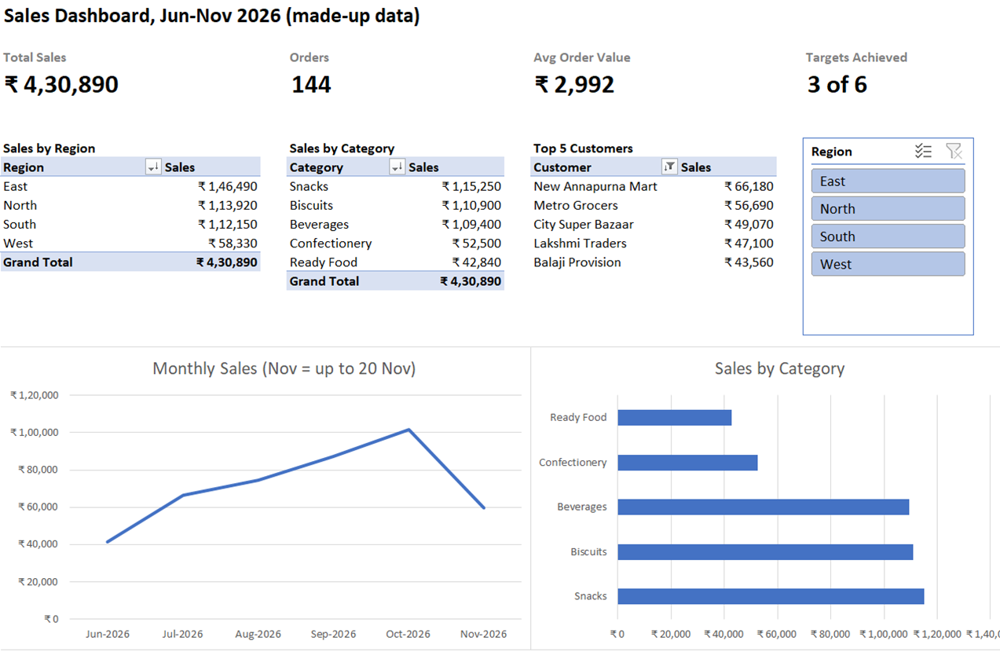
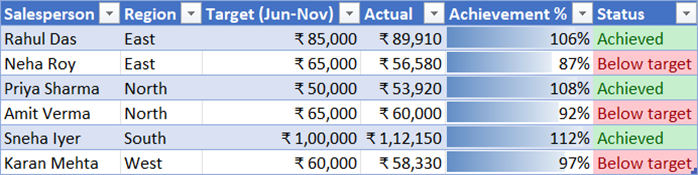
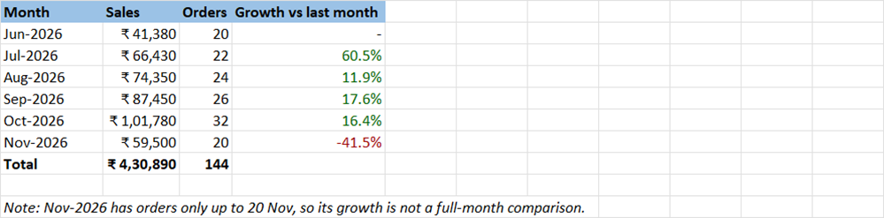
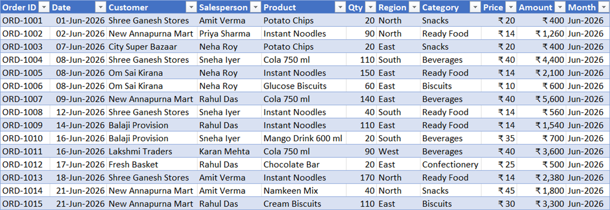

# 📈 Sales Dashboard: Regions, Products & Targets (Excel)

### 📖 Overview
A sales dashboard for a snacks and beverages distributor, built in **Microsoft Excel**.
It shows where sales come from (region, product category, customer), how sales move month to month, and which salespeople hit their targets.
*All data is made up (144 orders, Jun–Nov 2026), for demonstration only.*

### 🧰 Features
- **Orders sheet**: Region, Category and Price fill in automatically with XLOOKUP; dropdowns for salesperson and product
- **Monthly sheet**: sales and order count per month with SUMIFS and COUNTIFS, plus growth vs last month (green/red)
- **Team sheet**: target vs actual for each salesperson, achievement % with data bars, and "Achieved / Below target" status
- **Dashboard**: total sales, orders, average order value and targets achieved; sales by region, by category and top 5 customers
- **One Region slicer controls all pivot tables**, so one click answers "who are my top customers in North?"
- **Indian number format** (₹ 4,30,890)

### 💡 Skills Demonstrated
Excel Tables · XLOOKUP · SUMIFS · COUNTIFS · TEXT & DATE · IF · COUNTIF · Data Validation · Conditional Formatting (data bars) · Pivot Tables · Slicers · Charts

### 🖼️ Project Preview
#### Dashboard

#### Team targets

#### Monthly sales

#### Orders (first rows)

### 📁 Files
- [`sales-dashboard.xlsx`](./sales-dashboard.xlsx): Excel workbook
- [`Dashboard.png`](./Dashboard.png), [`Team.png`](./Team.png), [`Monthly.png`](./Monthly.png), [`Orders.png`](./Orders.png): screenshots

> **Note:** November has orders only up to 20 Nov, so its growth is not a full-month comparison.
> **How to update:** add rows to the Orders table, then click **Data → Refresh All** so the pivots update.
